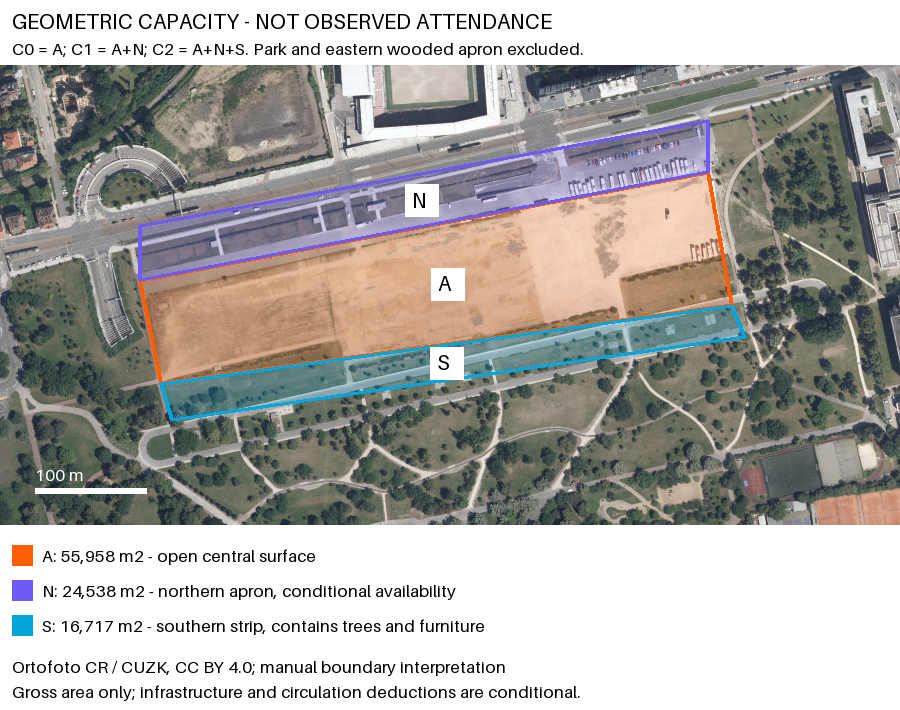

# Kolik lidí se vejde na Letenskou pláň

**Ověřen je mapový plošný výpočet pro přesně zveřejněné hranice. Kapacita závisí na hustotě a dostupné ploše; jednotné doložené maximum celého místa z těchto dat určit nelze.**

Tento výpočet není odhadem účasti 15. 11. 2026. Nepřebírá hustoty, zaplnění ani číslo účasti z předchozí analýzy.

## Výsledek při úplně volné ploše

| Vymezení | Hrubá plocha m² | Při 2 os./m² | Při 3 os./m² | Při 4 os./m² |
|---|---:|---:|---:|---:|
| C0: Pouze otevřená plocha | 55 958 | 111 915 | 167 873 | 223 831 |
| C1: Otevřená plocha + severní předprostor | 80 496 | 160 992 | 241 489 | 321 985 |
| C2: Rozšířená varianta s jižním pásem | 97 213 | 194 426 | 291 639 | 388 853 |

Jde o **hrubou geometrickou kapacitu při zvolené rovnoměrné hustotě**, před odpočty. Není to certifikovaná bezpečná kapacita ani fyzický absolutní strop. C0 není celá Letná; C2 je rozšířené pracovní vymezení, nikoli úřední hranice názvu Letenská pláň.



## Co přesně počítáme

- **C0** (A): Centrální otevřený povrch mezi severním předprostorem a jižní parkovou hranou, bez severního a jižního pásu.
- **C1** (A + N): C0 a severní zpevněný/pomocný prostor jižně od hlavní vozovky, pokud je uvolněn pro účastníky.
- **C2** (A + N + S): C1 a sousední jižní travnatý pás. Nezahrnuje celý park ani východní stromové předpolí.

Jižní park P, východní stromové předpolí F, stadion, vozovka Milady Horákové a celé Letenské sady nejsou do těchto variant zahrnuty. Severní prostor N se počítá podmíněně po uvolnění pro lidi; existující parkování, vybavení a případné bariéry jeho reálnou dostupnost snižují. Travnatý pás S zahrnuje i stromy a mobiliář, které vyžadují odpočty.

## Odpočty pro překážky, techniku a průchody

**Není doloženo přesné současné rozmístění a plocha všech překážek.** Proto je nulový odpočet v první tabulce výslovně jen hrubou referencí. Následující 10% a 20% rezervy jsou ukázkové předpoklady, nikoli změřený zábor nebo předpis. Pokrývají souhrnně pódium, kluziště, stánky, stromy, techniku a neobsazené průchody; jejich konkrétní plocha se nesmí vymýšlet.

| Vymezení | Rezerva | Dostupná plocha m² | 2 os./m² | 3 os./m² | 4 os./m² |
|---|---:|---:|---:|---:|---:|
| C0 | 10% | 50 362 | 100 724 | 151 086 | 201 448 |
| C0 | 20% | 44 766 | 89 532 | 134 299 | 179 065 |
| C1 | 10% | 72 447 | 144 893 | 217 340 | 289 786 |
| C1 | 20% | 64 397 | 128 794 | 193 191 | 257 588 |
| C2 | 10% | 87 492 | 174 983 | 262 475 | 349 967 |
| C2 | 20% | 77 771 | 155 541 | 233 311 | 311 082 |

Vzorec: **N = floor[(A − pevně vymezené vyloučené plochy) × (1 − další podíl rezervy) × hustota]**. V tabulkách se používá souhrnná procentní rezerva bez samostatného pevného odpočtu, aby se odpočty nezapočetly dvakrát. Každých vyloučených 1 000 m² odebere při 2/3/4 os./m² právě 2 000/3 000/4 000 míst.

## Ověření výpočtu

Ortofoto ČÚZK je uloženo v repozitáři, EPSG:32633. Měřítko je odvozené z vráceného rozsahu exportu (asi 0,899063457 m/px), nikoli z velikosti obrázku v prohlížeči. Kontroluje se SHA-256 mapy, úplný world file včetně posunu středu pixelu a souřadnice všech vrcholů.

Plochy jsou spočítány třemi cestami: (1) vlastní shoelace s Decimal v pixelech a převod měřítkem; (2) Shapely v metrické projekci; (3) pyproj.Geod na elipsoidu WGS84 po transformaci vrcholů. První dvě implementace musejí souhlasit do 0,0001 m²; geodetická a projekční plocha do 0,2 %. Pro kapacitní tabulky se používá **elipsoidální plocha**, takže drobný rozdíl od dřívější projekční výměry je očekávaný.

Kontroluje se také nepřekrývání složek, součet proti sjednocení a geodetická aditivita. Jde o různé výpočetní metody na téže mapě, **nikoli nezávislé geodetické zaměření hranic**. Měření bylo vizuálně zkontrolováno na uloženém ortofotu. Datum pořízení ortofota není doloženo; jde o ověření uložené mapy, nikoli aktuální terénní průzkum.

Ručně obkreslená hranice má nejistotu. JSON obsahuje citlivost na posun o ±3 a ±9 m; rozšíření může zasahovat mimo použitelný areál, proto není novou doloženou kapacitou ani statistickým intervalem. Shoda algoritmů neodstraňuje chybu hranice.

## Co znamená hustota a bezpečná kapacita

[Cornwall Council](https://www.cornwall.gov.uk/business-trading-and-licences/organising-an-event/health-and-safety-for-large-events/) uvádí při plošném plánování stojícího publika 0,5 m² na osobu (2 os./m²) po odečtení zařízení; současně požaduje prověřit evakuaci. Jde o britskou plánovací referenci, nikoli české povolení pro Letnou.

[G. Keith Still](https://www.gkstill.com/Support/crowd-density/CrowdDensity-1.html) poskytuje vizuální příklady různých hustot. Hodnoty 3 a 4 v tabulkách jsou matematické varianty hustého stojícího davu, nikoli potvrzení, že jsou vhodné pro celou pláň. CSV zahrnuje také 1 a 5 pouze jako citlivost; 5 není doporučený provozní cíl nebo zjištěné maximum.

[HSE](https://www.hse.gov.uk/event-safety/venue-site-design.htm) vyžaduje zohlednit průchody a únikové možnosti. Bez jejich parametrů nemáme ověřenou bezpečnou kapacitu: v JSON je proto certified_safe_capacity=null. Plošný součin sám ji nenahrazuje.

## Kontrola tvrzení 350 a 450 tisíc

| Vymezení | 350 tisíc: potřebná os./m² bez odpočtů | 450 tisíc: bez odpočtů | 350 tisíc: s 10% rezervou | 450 tisíc: s 10% rezervou |
|---|---:|---:|---:|---:|
| C0 | 6,25 | 8,04 | 6,95 | 8,94 |
| C1 | 4,35 | 5,59 | 4,83 | 6,21 |
| C2 | 3,60 | 4,63 | 4,00 | 5,14 |

Vyšší počet může využívat další plochy mimo toto vymezení; nebyl by však kapacitou jen C0/C1/C2. Z kapacity nelze vyvodit, kolik lidí skutečně přišlo, ani ji sčítat s již zahrnutými sektory předchozího modelu.

## Reprodukce a soubory

```sh
python -m pip install -r requirements.txt
python -m unittest discover -s tests -p test_capacity.py -v
python tools/capacity.py
```

Vstupy: [capacity.json](../data/capacity.json), [zdroje](../data/capacity_sources.json), [mapová metadata](../maps/cuzk_ortho.json). Výstupy: [JSON s výměrami, kontrolami a hashi](../results/capacity.json), [všechny přepočty CSV](../results/capacity.csv), [kontroly](../results/capacity_checks.json), [GeoJSON](../maps/capacity.geojson). [Spustitelný skript](../tools/capacity.py), [testy](../tests/test_capacity.py).

Mapový podklad: [ČÚZK Ortofoto](https://ags.cuzk.gov.cz/arcgis1/rest/services/ORTOFOTO/MapServer), [licence CC BY 4.0](https://ags.cuzk.gov.cz/opendata/). Zdroje byly otevřeny 17. 11. 2026. Výstup se generuje ze skutečně vypočtených hodnot; tento text se při reprodukci přepíše.
