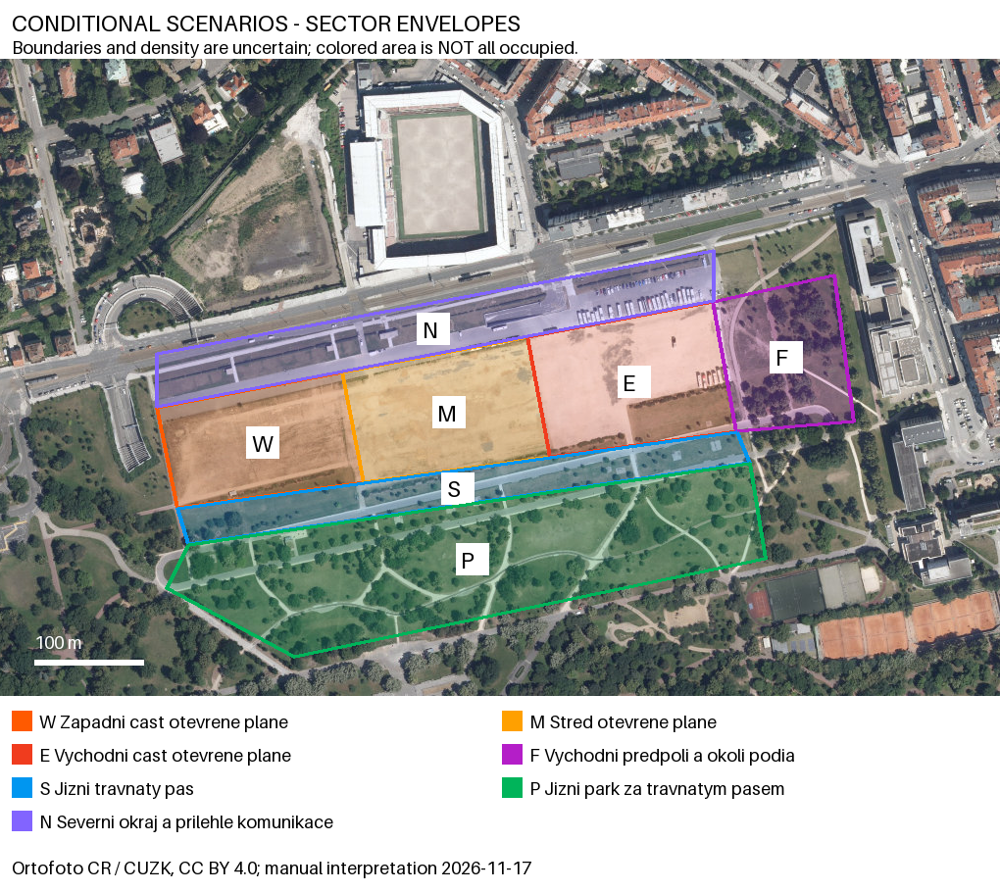

# Letná 15. 11. 2026 – podmíněný fotografický odhad

**Nejlepší pracovní odhad: asi 260 000 současně přítomných lidí. Široké modelové rozpětí: asi 140 000–440 000.**

Jde o mapový sektorový model s vizuálně zvolenými předpoklady obsazenosti a hustoty. **Není to počet spočítaných hlav, statisticky určená nejpravděpodobnější hodnota ani doložené minimum a maximum celé akce.** Střed je preferovaný pracovní scénář analytika. Ověřenou procentní přesnost určit nelze.

| Otázka | Závěr |
|---|---|
| Pracovní bodový odhad | Asi 260 tisíc, podmíněně podle níže uvedených předpokladů |
| Rozpětí scénářů | Asi 140–440 tisíc; skutečnost může ležet i mimo něj |
| Přesnost | Nízká; rozdíl scénářů −47 % až +69 % vůči středu není změřená chybovost ani interval spolehlivosti |
| Maximum dne | Jeden vysoký stav je použit jako přiblížení vrcholu; skutečné maximum není doloženo |
| Zadané tvrzení 350–450 tisíc | 350 tisíc je slučitelných s modelem; 450 tisíc není doloženo, ale není spolehlivě vyloučeno |

Dřívější verze obsahovala jen audit a null. Nynější doplnění poskytuje čísla s otevřenými předpoklady. Přísný kalkulátor kalibrovaných měření stále vrací null; scénářový kalkulátor vytváří výsledky výše. Chybějící měření nebylo označeno za existující.

## Fotografie a datum

Skutečně bylo staženo **75 různých URL souborů, celkem 80 295 295 bajtů**. Nejde o 75 nezávislých pohledů: existují varianty a podobné záběry. [Evidence stažení](../data/photo_acquisition.json) obsahuje URL, rozměry, EXIF a SHA-256. Celý archiv nebyl automaticky přijat do odhadu.

Základ: **SZ-GALLERY-102-UNCROPPED**, Michal Turek / Seznam Zprávy, 3000 × 2001 px. Dobová galerie výslovně označuje demonstraci 15. listopadu. EXIF uvádí **15. 11. 2026 14:22:40 +01:00**, jméno autora a odpovídající datum. Orientační body Letné, scénografie a uspořádání odpovídají reportáži. Jde o doložený publikovaný redakční soubor této akce, nikoli ověřený soubor přímo z paměťové karty.

**SZ-ALBUM-19**, 3000 × 2001 px, EXIF **14:58:48 +01:00**, stejná galerie: kvalitativní kontrola pokračující vysoké účasti. Jeho lidé se nepřičítají. Policejní náhled publikovaný Novinkami ukazuje prostor z opačné strany, ale nemá doložený přesný čas; není synchronizovaným číselným vstupem.

[Doklady původu a role jednotlivých snímků](../data/scenario_evidence.json). Neověřené fotografie, fotobanky, jiné demonstrace a přípravy 14. 11. nejsou číselným vstupem. Snímek před zahájením ani SinMed s nevyřešeným EXIF pásmem +02:00 nebyly použity k určení času vrcholu.

Fotografie byly staženy do soukromé pracovní složky runneru. Oprávnění k přetištění není doloženo: Git uchovává odkazy a metadata. Později odstraněný soubor nelze z hashe obnovit.

## Měřítko a sektory

Použito **Ortofoto ČR / ČÚZK**, CC BY 4.0, export 2400 × 1800 px, EPSG:32633. Měřítko ze skutečně vráceného souřadnicového rozsahu je **0,899063457 m/pixel** v obou osách. Nejde o odečítání pixelů obrazovky. Mapa sama nedokládá zaplnění v den demonstrace.



Barevné polygony jsou **obálky sektorů**, nikoli tvrzení o úplném zaplnění. Zvlášť je západ, střed a východ pláně, předpolí, jižní pás, jižní park a převážně prázdný severní okraj. Stadion a celý širší park nejsou považovány za zaplněné.

Přesné body: [vstupní JSON](../data/quantitative_scenarios.json); zeměpisná geometrie: [GeoJSON](../maps/scenario_sectors.geojson). Plochy polygonů jsou mapově změřené. Hranice skutečného davu nejsou přesně georeferencovány; zejména park a předpolí představují modelové aproximace.

## Výpočet

**Počet = plocha polygonu × faktor nejistoty plochy × podíl obsazenosti × hustota na obsazené části.**

Podíl obsazenosti souhrnně odečítá mezery, koridory, kluziště, techniku, pódium a stromy. Nejde o přesně zaměřené jednotlivé překážky; jejich vliv je odhadnutý a mezi scénáři se mění.

| Sektor | Hrubá obálka m² | Střední obsazenost | Předpokládaná hustota os./m² | Střední počet |
|---|---:|---:|---:|---:|
| W: západ pláně | 17 082 | 89 % | 2,8 | 42 568 |
| M: střed pláně | 18 639 | 89 % | 3,3 | 54 741 |
| E: východ pláně | 20 195 | 89 % | 3,6 | 64 706 |
| F: předpolí a okolí pódia | 14 169 | 55 % | 3,4 | 26 495 |
| S: jižní pás | 16 704 | 82 % | 2,6 | 35 613 |
| P: jižní park | 52 853 | 45 % | 1,4 | 33 298 |
| N: severní okraj | 24 520 | 8 % | 1,0 | 1 962 |
| **Součet** | **164 162** | **efektivně 97 001 m²** | **průměr 2,67** | **259 383** |

Hrubá obálka 16,4 ha tedy není celá považována za hustý dav. Střední efektivně obsazená plocha je asi **9,7 ha**. Přesnost aritmetiky není přesností odhadu; publikujeme zaokrouhlení na desetitisíce.

Na hlavním snímku je souvislý dav, v popředí sevřenější. V parku jsou mezery a volné trávníky, na severu převládá volná plocha. Toto pozorování vede k rozdílným sektorům. **Konkrétní koeficienty jsou úsudek analytika, nikoli naměřené hustoty z kalibrovaných vzorků.**

Orientační interpretaci doplňuje [vizuální přehled G. Keitha Stilla](https://www.gkstill.com/Support/crowd-density/CrowdDensity-1.html); není měřením Letné. Nízký úhel může zvýšit zdánlivou hustotu. Bezpečnostní kapacitní limity nejsou použity jako skutečná hustota.

Ve starším výřezu bylo označeno 23 rozeznatelných hlav a tři nejisté kandidáty. [Anotace](../data/manual_sample.json) je neúplný výběr viditelných hlav, nemá určenou plochu v m² ani korekci překrytí a nebyla extrapolována. Nové výřezy tento problém neodstranily. Nevalidovaný automatický výstup nebyl vydáván za celkový počet.

Kluziště nebylo použito jako přesná perspektivní kalibrace: [Praha 7](https://www.praha7.cz/kluziste-26/) uvádí 43 × 20 m, [provozovatel](https://www.ice-tec.cz/kluziste-praha-letna.php) 43 × 25 m. Rozpor a nejisté kontrolní body brání spolehlivé kalibraci jediným obdélníkem. [Evidence](../data/rink_scale_sources.json).

## Rozpětí, čas a nejistoty

Výpočet dává **136 474 / 259 383 / 437 983**. Kompletní násobení: [CSV](../results/scenario_sectors.csv), [výsledek JSON](../results/scenario_estimate.json). Parametry všech variant jsou zveřejněny.

Nízký a vysoký scénář společně mění hranice, zaplnění a hustotu. **Nejde o 95% interval, změřenou chybu ani fyzikální mez.** Pravděpodobnost jednotlivých scénářů neznáme. Parková obálka je podstatně větší než její předpokládaná zaplněná část.

Hlavní nejistoty jsou hustota pláně, zakrytí stromy, rozsah zaplnění parku, technické odpočty a čas maxima. Změna průměrné hustoty o 0,5 osoby/m² na střední obsazené ploše změní počet asi o **48 500**; změna obsazené plochy o 10 % při stejných hustotách asi o **26 000**.

Časový základ je **14:22:40**. Pozdější snímek 14:58:48 ukazuje další vysoký stav, ale nedokládá stejné zaplnění ani maximum dne. **Počty z různých časů se nesčítají.** Přiblížení vrcholu platí pod předpokladem, že vybraný stav byl vrcholu blízký. Tento předpoklad nebyl nezávisle prokázán.

Druhý pohled a jiný čas poskytují kvalitativní kontrolu rozsahu, nikoli druhý kalibrovaný počet. Jediná číselná metoda je mapová plocha krát předpokládaná hustota; nezávislý census ani validovaný detektor ji nepotvrzuje.

## Porovnání se zadanými 350–450 tisíci

Porovnání následovalo po sektorovém součtu. Číslo bylo známo už ze zadání, takže **nešlo o zaslepený odhad**. Autorita organizátorů ani mediální opakování nejsou kalibračním údajem.

Na střední obsazené ploše 97 001 m² by 350 tisíc vyžadovalo průměr **3,61 os./m²**, 450 tisíc **4,64 os./m²**. Větší obsazená plocha požadavek snižuje, menší zvyšuje. Hustotu popředí nelze přenést na celý park.

**Fotografie konkrétní interval 350–450 tisíc nepotvrzují.** 350 tisíc do scénářů zapadá. 450 tisíc by vyžadovalo kombinaci velkého zaplnění a vysokých hustot, případně další účastníky mimo model. Těsné překročení horního scénáře však není důkazem nepravdivosti tvrzení. Preferovaný střed je nižší, s velkou nejistotou.

## Reprodukce a ověření

Výpočty proběhly na uživatelově **self-hosted Windows runneru**, Python 3.12. [Kontroly scénáře](../results/scenario_check.json) ověřují mapový hash a měřítko, nepřekrývání základních sektorů, konečnost a pořadí parametrů a obsazenost do 100 %. Deset testů přísného kalkulátoru a testy přenosu obrazů kontrolují software, nikoli správnost vizuálních předpokladů.

```sh
python -m pip install -r requirements.txt
python tools/verify.py
node tools/review_transport.mjs self-test
python tools/reference_geometry.py
python tools/quantitative_scenarios.py
python tools/download_photos.py
```

Scénáře běží z uložené mapy a JSON bez nového stahování. Poslední příkaz potřebuje síť a obnovuje soukromé fotografie podle URL a hashů. Reprodukovatelnost výpočtu neznamená nezávislé prokázání správnosti úsudku.

Primární zdroje: [galerie Seznam Zpráv](https://www.seznamzpravy.cz/clanek/obrazem-obrazem-andreji-macinko-okamuro-mame-toho-dost-letna-proti-zestatneni-medii-320577), [výškový pohled](https://www.seznamzpravy.cz/clanek/domaci-zivot-v-cesku-video-takto-vypada-plna-letna-z-vysky-320595), [policejní video publikované Novinkami](https://www.novinky.cz/clanek/domaci-zabery-z-dronu-ukazaly-statisice-lidi-na-letne-40608773), [ČÚZK ortofoto](https://ags.cuzk.gov.cz/arcgis1/rest/services/ORTOFOTO/MapServer), [otevřená data a licence](https://ags.cuzk.gov.cz/opendata/). Další doklady a historie jsou v data/, docs/ a historii main.

## Samostatný výpočet kapacity

Doplněn [ověřený plošný výpočet kapacity Letenské pláně](CAPACITY.cs.md), s přesným vymezením ploch a variantami hustoty a odpočtů. Geometrická kapacita není novým měřením účasti a nemění výše uvedený fotografický scénář.
